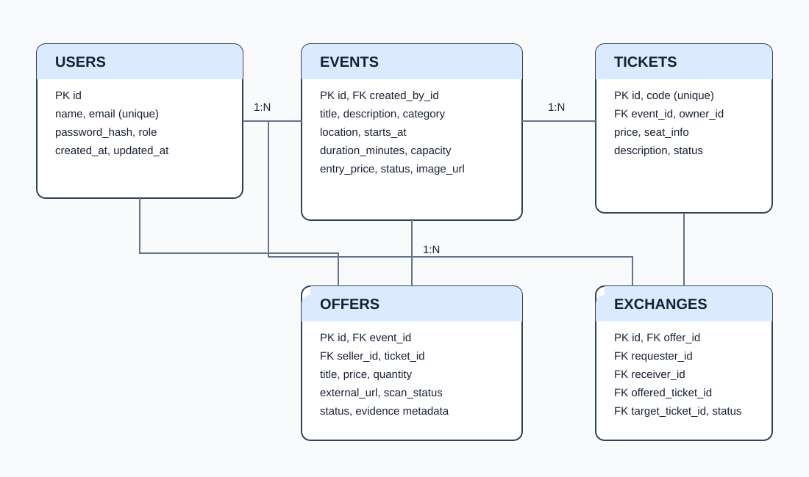

# TicketGuard OpenBuy — versión 7

Sistema web de gestión de eventos y entradas con catálogo público, compra, historial de entradas, transferencias, publicaciones para intercambios y un módulo administrativo de análisis defensivo de enlaces (honeypot).

## Cambios de v7

- Se incorporó edición de eventos desde el panel administrativo, reutilizando el formulario para alta y modificación.
- Se incorporó el listado de compradores en el reporte administrativo.
- Se agregaron confirmaciones y manejo de errores al dar de baja eventos.
- Se agregaron validaciones HTML preventivas al formulario de eventos.
- Las compras bloquean la fila del evento durante la verificación del cupo; la compra desde publicaciones también bloquea la publicación para evitar consumir la misma cantidad simultáneamente.
- La actualización de capacidad rechaza valores inferiores a las entradas activas existentes.
- Se agregaron pruebas unitarias para normalización de dominio, roles, validación de eventos y hashing de contraseñas.
- Se agregó diagrama de base de datos en SVG y guía de GitFlow.
- Se incorporó un workflow de CI para ejecutar tests y build.
- Se retiró el `.env` local del paquete. Las credenciales deben configurarse a partir de `.env.example`.

## Tecnologías

- Backend: Go 1.23, Gin, GORM, JWT y bcrypt.
- Frontend: React y Vite.
- Base de datos: MySQL 8.
- Infraestructura: Docker y Docker Compose.
- Administración de base de datos: phpMyAdmin.

## Requisitos previos

- Docker Desktop con Docker Compose v2.
- Git.
- Para ejecución manual: Go 1.23 y Node.js 22 con npm.

## Configuración y ejecución con Docker

1. Clonar el repositorio.
2. Crear el archivo de configuración local:

   ```bash
   cp .env.example .env
   ```

   En Windows PowerShell:

   ```powershell
   Copy-Item .env.example .env
   ```

3. Editar `.env` y reemplazar `DB_PASSWORD`, `MYSQL_ROOT_PASSWORD` y `JWT_SECRET` por valores propios y fuertes. No subir `.env` a Git.
4. Construir y levantar:

   ```bash
   docker compose build
   docker compose up -d
   docker compose ps
   ```

5. Consultar logs:

   ```bash
   docker compose logs -f backend
   ```

6. Para detener:

   ```bash
   docker compose down
   ```

   Para borrar también los datos persistidos de MySQL (acción destructiva):

   ```bash
   docker compose down -v
   ```

## URLs locales

- Frontend: http://localhost:5173
- API: http://localhost:8080/api
- Salud del backend: http://localhost:8080/health
- phpMyAdmin: http://localhost:8081
- MySQL desde el host: `localhost:3307`

## Usuarios de demostración

La aplicación inicializa cuentas de demostración en el primer arranque de la base vacía:

| Rol | Usuario | Contraseña |
|---|---|---|
| Administrador | `admin@ticketguard.test` | `Admin123!` |
| Cliente | `usuario@ticketguard.test` | `Usuario123!` |
| Cliente | `intercambio@ticketguard.test` | `Usuario123!` |

Cambiar o eliminar estas credenciales antes de cualquier despliegue público. Son exclusivamente para demostración local.

## Funcionalidades

### Cliente

- Catálogo público, búsqueda, filtros y detalle de eventos.
- Registro e inicio de sesión.
- Compra de entradas con control de cupo.
- Visualización de entradas propias.
- Cancelación y transferencia de entradas.
- Publicaciones asociadas a entradas y solicitudes de intercambio.

### Administrador

- Alta, edición y baja lógica de eventos.
- Reporte de entradas activas, capacidad, disponibilidad y ocupación.
- Listado de compradores.
- Panel de alertas del honeypot y consulta de evidencia.

### Seguridad y Bonus Track

El módulo de análisis de enlaces aplica reglas locales y puede integrarse con VirusTotal cuando se configura `VT_API_KEY`. Sin esa clave, el sistema no consulta VirusTotal. El honeypot almacena metadatos de la solicitud y telemetría básica voluntariamente enviada por el navegador; no obtiene archivos ni contraseñas del dispositivo.

La aprobación formal del Bonus Track debe acreditarse mediante el correo o constancia del docente; el código fuente no demuestra esa aprobación.

## Estructura del repositorio

```text
backend/
  clients/       Integraciones externas
  config/        Configuración
  controllers/   Controladores HTTP
  dao/           Acceso a datos
  domain/        Entidades y reglas del dominio
  middleware/    Autenticación y autorización
  services/      Lógica de negocio
  utils/         Utilidades
frontend/
  src/           Aplicación React
 docs/
  db-diagram.mmd
  db-diagram.svg
  api-summary.md
  GITFLOW.md
```

## Diagrama de base de datos



Fuente editable: [`docs/db-diagram.mmd`](docs/db-diagram.mmd).

## Ejecución manual

Backend:

```bash
cd backend
go mod download
go run .
```

Frontend, en otra terminal:

```bash
cd frontend
npm install
npm run dev
```

Configurar las variables de entorno del backend y `VITE_API_URL` para que apunte a la API correcta.

## Testing y cobertura

```bash
cd backend
go mod tidy
go test ./... -coverprofile=coverage.out
go tool cover -func=coverage.out
go tool cover -html=coverage.out
```

Frontend:

```bash
cd frontend
npm install
npm run build
```

**Importante:** el objetivo de examen es 80% de cobertura backend. La existencia de estos comandos y del workflow no acredita por sí sola ese porcentaje: debe ejecutarse en un entorno con dependencias disponibles, guardar el resultado y ampliar las pruebas hasta alcanzar el umbral. Las pruebas incorporadas en v7 son una base inicial, no una certificación del 80%.

## Capturas para la defensa

Ver `docs/screenshots/README.md`. Las capturas deben tomarse de una ejecución real; no se agregan imágenes ficticias como evidencia.

## GitFlow

Consultar `docs/GITFLOW.md`. La adopción efectiva de GitFlow y el trabajo colaborativo se acreditan con ramas, Pull Requests y commits del repositorio remoto, no solamente con esta guía.

## Endpoints principales

### Autenticación

```text
POST /api/auth/register
POST /api/auth/login
POST /api/me/password
```

### Públicos

```text
GET /api/events
GET /api/events/:id
GET /api/events/:id/offers
```

### Cliente autenticado

```text
POST /api/events/:id/buy
GET  /api/me/tickets
POST /api/tickets/:id/cancel
POST /api/tickets/:id/transfer
GET  /api/me/offers
POST /api/me/offers
POST /api/offers/:id/exchange
GET  /api/me/exchanges/inbox
GET  /api/me/exchanges/sent
POST /api/exchanges/:id/accept
POST /api/exchanges/:id/reject
```

### Administrador

```text
POST   /api/admin/events
PUT    /api/admin/events/:id
DELETE /api/admin/events/:id
GET    /api/admin/events/:id/report
GET    /api/admin/security/offers
POST   /api/admin/security/alerts/clear
```

## Decisiones de diseño

1. Se separa la compra general de la solicitud de intercambio publicada por otros usuarios.
2. Las transferencias y aceptaciones de intercambio se ejecutan en transacciones para mantener atómica la modificación de titularidad.
3. Se usa baja lógica para eventos, preservando referencias históricas.
4. Las publicaciones bloqueadas no muestran detalles técnicos al cliente; la evidencia queda en el panel administrativo.
5. Las alertas limpiadas se marcan como tales y no se elimina la evidencia histórica.
